<a href="https://sykbot.com"><b>Open Sykbot</b></a> &nbsp;·&nbsp; <a href="./SUPPORT.md"><b>Support</b></a> &nbsp;·&nbsp; <a href="./SECURITY.md"><b>Security</b></a> &nbsp;·&nbsp; <a href="./CHANGELOG.md"><b>Changes</b></a> &nbsp;·&nbsp; <a href="https://github.com/loverhaterlmao/snns-suite"><b>All S&NS projects</b></a>

 

<!-- v2:a -->
<table>
<tr>
<td width="150" align="center"></td>
<td>
<b>Sykbot for Windows</b>: a small window onto sykbot.com with its own icon, its own start screen, and a frame that takes the app's colour.  
  <b>On a phone:</b> open <a href="https://sykbot.com">sykbot.com</a> in your browser and choose <i>Add to Home Screen</i> (iPhone: the Share button; Android: the menu, then <i>Install app</i>).
</td>
</tr>
</table>
<!-- /v2:a -->

## What it is

Moderation, verification, anti-raid, tickets and logging, all set up inside Discord. Member data stays in Discord unless you switch on an optional check.

**Open it:** [sykbot.com](https://sykbot.com)

Docs: [sickenn.info](https://sickenn.info) · Your account: [sicken.me](https://sicken.me)

Sykbot is made by Sick & Nexra Studios (S&NS). Its source code is closed. This repository is where to find it, how
to get help, and where to report problems.

<!-- v2:b -->
## The desktop app

- **Getting it:** [the latest release](https://github.com/loverhaterlmao/sykbot/releases/latest). Unzip it and open `Sykbot.exe` once. It puts itself with your own programs (no administrator rights), appears in your Start menu and under Installed apps, and opens from there from then on. `--portable` runs it where it is and installs nothing.
- **What it is:** [sykbot.com](https://sykbot.com) in a window of its own. With no connection it shows its own screen and opens the site by itself when the connection is back; it opens where you closed it. Your work stays in your account on the site.
- **What it needs:** Windows 10 or 11. It uses the WebView2 runtime, which Windows 11 has built in.
- **The warning Windows shows:** "unknown publisher", the first time. The app is not code-signed yet. Check the file's
  SHA-256 against the one in the release notes if you want to be sure it is ours.

## Built with

  

The source is closed, so GitHub's own language bar has nothing to count here. This is what Sykbot is written in and runs on.

## The small print

[Terms of use](TERMS.md) · [Privacy](PRIVACY.md) · [Acceptable use](ACCEPTABLE_USE.md) · [Licence](LICENSE)
<!-- /v2:b -->

## In this repository

| File | |
|---|---|
| [SUPPORT.md](SUPPORT.md) | Reaching a person |
| [SECURITY.md](SECURITY.md) | Reporting a weakness |
| [CONTRIBUTING.md](CONTRIBUTING.md) | How to help when the source is closed |
| [CODE_OF_CONDUCT.md](CODE_OF_CONDUCT.md) | How we treat each other here |
| [CHANGELOG.md](CHANGELOG.md) | What changed, and when |
| [LICENSE](LICENSE) | What you may and may not do |

Terms of use, acceptable use and privacy for every S&NS project: [LEGAL.md](https://github.com/loverhaterlmao/snns-suite/blob/main/LEGAL.md).

## Issues

Use this repository's issues for things that are broken or missing in Sykbot. Say what you did, what you expected
and what happened. Never put passwords, keys or personal details in an issue. Security weaknesses do not go here.

 

Part of the S&NS family 
<a href="https://github.com/loverhaterlmao/noetic-suite"><b>Noetic Suite</b></a> &nbsp;·&nbsp; <a href="https://github.com/loverhaterlmao/claw"><b>Claw</b></a> &nbsp;·&nbsp; <a href="https://github.com/loverhaterlmao/sykbot"><b>Sykbot</b></a> &nbsp;·&nbsp; <a href="https://github.com/loverhaterlmao/beat-rip"><b>Beat.rip</b></a> &nbsp;·&nbsp; <a href="https://github.com/loverhaterlmao/ink"><b>Ink</b></a>  
<a href="https://snns.dev"><b>snns.dev</b></a> &nbsp;·&nbsp; <a href="https://github.com/loverhaterlmao/snns-suite">S&NS Suite</a> &nbsp;·&nbsp; <a href="mailto:support@snns.dev">support@snns.dev</a>

© Sick & Nexra Studios. All rights reserved. No licence to the software is granted by this repository.

